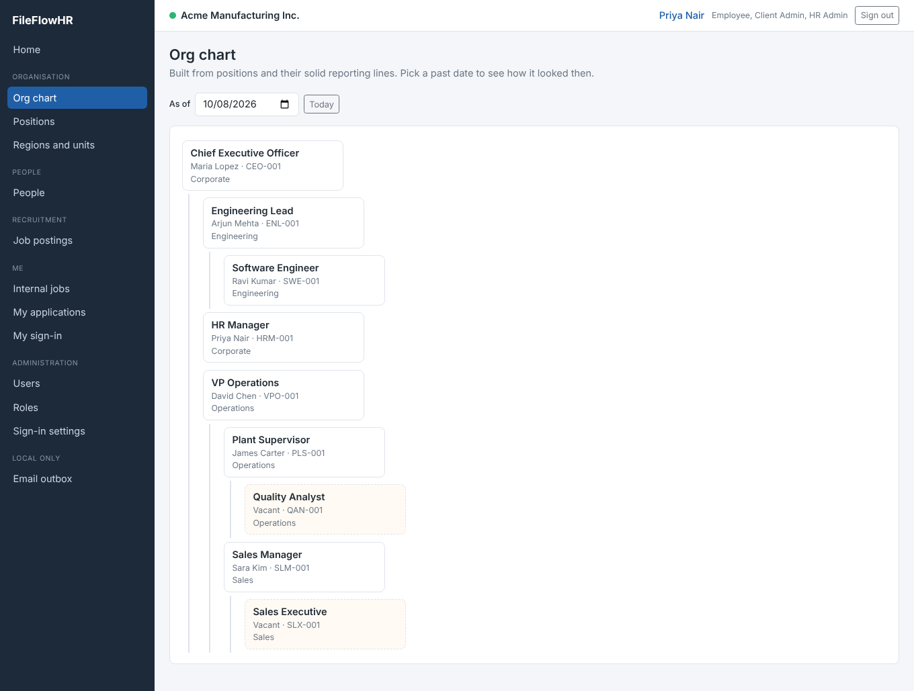

# FileFlowHR (kickoff build)

FileFlowHR is a multi-company HR app: organisation (regions, business units, positions, org chart), people (hire, move,
cover, leave), recruitment (postings, applications, hiring) and sign-in that works whether or not a company has
its own login system.

- **.NET 10 (LTS)**, Blazor Web App, **Interactive Server**
- **One shared SQL Server database** for many companies. Every company table has `CompanyId`; the app filters by
  the signed-in company automatically.
- **Clean architecture**, SOLID, CQRS-style use cases, 16 automated tests.



---

## 1. Run it

### Option A: Visual Studio 2022 (17.14+) or Rider, with SQL Server LocalDB

1. Install the [.NET 10 SDK](https://dotnet.microsoft.com/download/dotnet/10.0). LocalDB comes with Visual Studio.
2. Open `FileFlowHR.slnx`, set **FileFlowHR.Web** as the startup project, press **F5** (profile `https`).
3. First start creates the `FileFlowHR` database (migrations) and loads demo data for two companies.
4. The browser opens at https://localhost:7180.

Using a full SQL Server instead? Copy `src/FileFlowHR.Web/appsettings.Development.json.example` to `appsettings.Development.json` (git-ignored, so your credentials stay out of the repo) and set `ConnectionStrings:FileFlowHR` there.

### Option B: No SQL Server (SQLite file)

Pick the launch profile **"https (SQLite, no SQL Server)"**, or from a terminal:

```bash
cd src/FileFlowHR.Web
# Windows PowerShell: $env:FILEFLOWHR_DB="Sqlite"; dotnet run --launch-profile https
FILEFLOWHR_DB=Sqlite dotnet run --launch-profile https
```

This creates `fileflowhr.db` next to the app. Delete the file to start again with fresh demo data.
SQLite has no history tables, so use SQL Server to see temporal history.

If the browser warns about the certificate, run `dotnet dev-certs https --trust` once.

### Run the tests

```bash
dotnet test
```

The tests use the real wiring on an in-memory SQLite database. No SQL Server needed.

---

## 2. Try it

The password for every demo account is `FileFlowHR#2026`. On the sign-in page, enter the email; the company is found from it.

| Company | Email | Who | What to try |
|---|---|---|---|
| Acme | priya.nair@acme.com | HR Manager, client admin | Everything: org chart, hire, invite, roles, sign-in settings |
| Acme | sara.kim@acme.com | Sales Manager, recruiter for Engineering | Sees only Engineering postings |
| Acme | david.chen@acme.com | VP Operations, auditor for US East | Read-only within US East |
| Acme | ravi.kumar@gmail.com | Software Engineer | Own record, find jobs, apply |
| Acme | tom.baker@outlook.com | Applicant | My applications |
| Acme | linda.park@gmail.com | Former employee | Sign-in is refused (login disabled) |
| Globex | jane.doe@globex.com | Admin | Sees only Globex data |
| Globex | meena.iyer@gmail.com | Applicant | Globex jobs only |

Things worth showing the team:

1. **Hire someone end to end.** Open the careers page (`/careers/acme`), create an applicant account, confirm the
   email from the **Email outbox** (`/dev/mailbox`, local only), apply. Then sign in as Priya, open the posting,
   move the application to Offer and click **Hire**. The person is now an employee in the position and on the org chart.
2. **Invite a member of staff.** People → Add person → Invite to sign in. Open the invite from the Email outbox and
   set a password.
3. **Company isolation.** Sign in as Jane (Globex). Nothing from Acme appears anywhere.
4. **History.** Org chart → pick an earlier date. Positions → "Show closed". Nothing is ever deleted.
5. **MFA.** Admin → Sign-in settings → require an authenticator app. Staff are asked to set it up at next sign-in.

---

## 3. How sign-in works

Each company chooses, in **Admin → Sign-in settings** (table `CompanyLoginProvider`):

- **Email and password (built in)** for companies without their own login system. ASP.NET Core Identity stores a
  salted hash, never the password. Lockout after 5 failed tries, optional authenticator-app MFA.
- **Company login (OpenID Connect)**: Microsoft Entra ID, Okta, Google Workspace and so on. The button appears on
  the sign-in page; staff are matched by email to an invited login. The client secret is **not** in the database:
  put it in configuration as `LoginSecrets:<secret name>` (user secrets locally, Key Vault later).
- **Applicants** always register with email and password.
- **SAML** is planned for later; the table already allows it.
- We never connect to a client's own user database. Their users are imported/invited, or they use OIDC.

User names are `companycode:email`, so the same email can exist at two companies.

The sign-in page asks for the email first and works out the company from it: a company login that claims the email domain (jane@globex.com finds Globex), otherwise the companies where that account exists (applicants on gmail.com). If one email is registered at several companies, a short picker appears. Links from careers pages (`?company=acme`) skip this step. A company can also come from the web address
(`acme.fileflowhr.com`).

---

## 4. Architecture

```
src/
  FileFlowHR.Domain          Entities and business rules. No dependencies.
  FileFlowHR.Application     Use cases (commands/queries), validation, permissions. Depends on Domain only.
  FileFlowHR.Infrastructure  EF Core, SQL Server/SQLite, ASP.NET Core Identity, OIDC, email, demo data.
  FileFlowHR.Web             Blazor pages. Talks to Application only through IDispatcher.
tests/
  FileFlowHR.Tests           Domain rules, company isolation, permissions, hiring flow.
database/
  FileFlowHR-Create.sql   The SQL Server script EF generates, for DBAs to review.
```

Dependencies point inwards: Web → Application → Domain; Infrastructure implements Application's interfaces.

### Patterns used

| Pattern | Where | Why |
|---|---|---|
| Clean architecture | 4 projects above | Business rules don't depend on UI or database |
| CQRS-style use cases | `Application/Features/**` (one record + one handler each) | Small, testable units; pages stay thin |
| Mediator + pipeline | `Common/Messaging/Dispatcher.cs`, `Common/Behaviors` | Error handling, permission checks and validation run the same way for every use case |
| Result pattern | `Common/Result.cs` | Expected failures (invalid, not found, forbidden) are values, not exceptions |
| Rich domain model | `Domain/**` (`Employment.Hire`, `JobApplication.MoveTo`, …) | Rules live with the data; impossible states can't be created |
| Effective dating | `EffectiveDatedEntity` | Org history: rows get end dates, never deleted |
| Multi-tenancy by query filter | `FileFlowHRDbContext` + `CompanyStampingInterceptor` | Every read filtered by company; every write stamped; deletes blocked |
| Unit of work / repository | EF Core `DbContext` behind `IAppDbContext` | No extra repository layer to maintain |
| Options pattern | `AppOptions` | Typed settings |
| Policy-based authorization | `Web/Security/PermissionPolicies.cs` | Same permission rules in the UI and in the use cases |

### SOLID in this code

- **Single responsibility**: one handler per use case; `StaffingService` owns hiring rules, `ReportingLineService` owns manager changes.
- **Open/closed**: new behaviour (logging, auditing) is a new pipeline behaviour, not edits to every handler. New use cases are found by reflection.
- **Liskov**: every `Result`/`Result<T>` is handled the same way by the pipeline (`IResultFactory<T>`).
- **Interface segregation**: small interfaces (`ICurrentUser`, `ICompanyContext`, `IUserAccountService`, `IEmailSender`).
- **Dependency inversion**: Application defines interfaces; Infrastructure implements them; Web wires them up in `Program.cs`.

### Permissions

Roles are fixed in code (`Application/Common/Security/Permissions.cs`). Only grants are stored (`RoleGrant`).

- Automatic: **employee** (own record, find jobs), **manager** (their team), **applicant** (own applications).
- Granted: **client admin**, **HR admin**, **recruiter**, **auditor**, each for the whole company, one region or one business unit.
- Role changes apply at the user's next sign-in.

### Database

17 tables, PascalCase. On SQL Server the history tables (system-versioned temporal tables) record every change.
Filtered unique indexes stop two current holders of one position, two open employments for one person, and two
current main managers for one position.

To change the schema: edit the entity and its configuration, then

```bash
dotnet tool restore
dotnet ef migrations add <Name> -p src/FileFlowHR.Infrastructure -s src/FileFlowHR.Web -o Persistence/Migrations
```

---

## 5. Not in this kickoff build

- SAML sign-in, subdomain-per-company routing, the catalog database (plans, subscriptions).
- Real email sending (the local Email outbox stands in; swap `DevMailbox` for Azure Communication Services or SMTP).
- Résumé upload, interview scheduling, payroll fields, audit-log screen.
- Roles refresh at next sign-in, not instantly.
